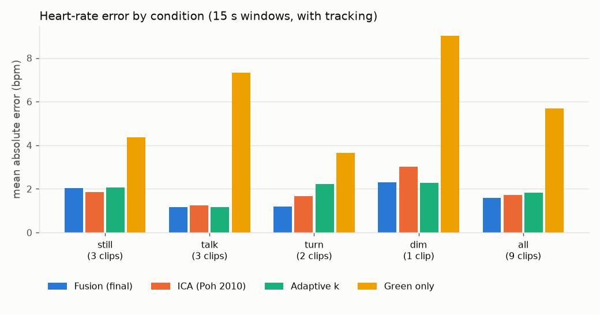
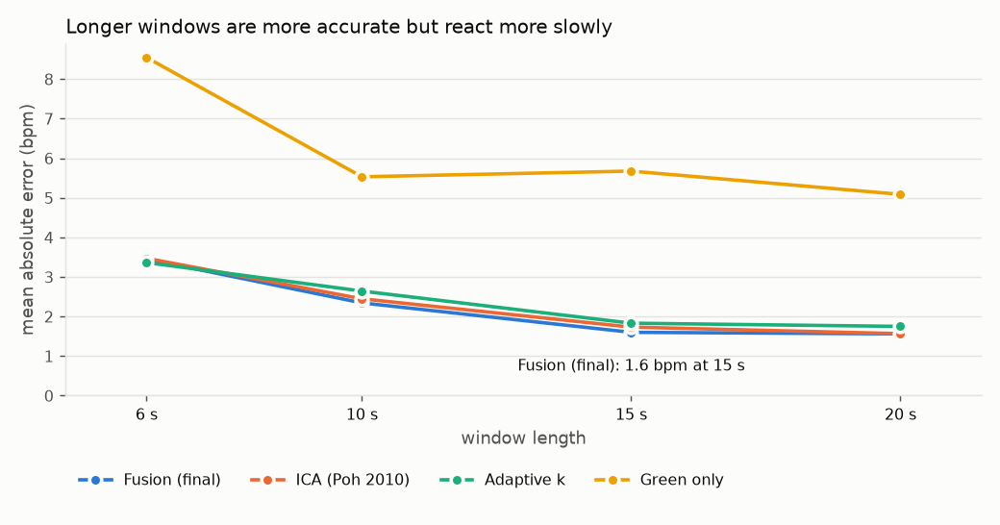

# Contactless Heart Rate Monitoring via Webcam Signal Processing

Measures heart rate from an ordinary laptop webcam, with no contact sensor, by
tracking the tiny color changes in facial skin caused by each heartbeat
(remote photoplethysmography, or rPPG).

**Result:** on 9 recordings (still, talking, head turns, dim light), the final
method averages **1.6 bpm error, with 87% of estimates within 3 bpm**. That is
**33% less error than the ICA baseline** (2.4 bpm) and **72% less than using the
green channel alone** (5.7 bpm).



## Credit

The baseline is the ICA method from Poh, McDuff & Picard, *"Non-contact,
automated cardiac pulse measurements using video imaging and blind source
separation,"* Optics Express 18(10), 2010. I rebuilt it from scratch and
used it as the method to beat. The adaptive-k method, the SNR fusion, the
Kalman tracking, and the evaluation setup are my own work.

## How it works

1. **Capture** (`capture.py`): 30 s of 640×480 video at about 30 fps,
   saved losslessly (FFV1) with a timestamp for every frame. Requesting MJPG
   from the camera raised the frame rate from 9.9 to 29.7 fps.
2. **Skin signal** (`extract_rgb.py`): MediaPipe finds 478 face landmarks
   per frame. The R, G, B values are averaged over a mask covering the
   forehead and both cheeks.
3. **Cleaning**: resample onto an even time grid using the real timestamps
   (the FFT assumes even spacing), convert to relative change, detrend, and
   band-pass to 0.75–4 Hz (45–240 bpm).
4. **Pulse extraction**: several methods, all on the same 15 s sliding windows
   (see below).
5. **Heart rate**: FFT of each window; the spectral peak gives bpm.
6. **Tracking** (`tracking.py`): a Kalman filter follows heart rate across
   windows, so one noisy window can't jump the estimate by 30 bpm.

## Methods compared

| Method | Idea |
| --- | --- |
| Green only | The green channel carries the strongest pulse (hemoglobin absorbs green light), but also all the noise |
| ICA (baseline) | Independent Component Analysis unmixes R, G, B; pick the component with the tallest spectral peak |
| Adaptive k | Motion and lighting noise hits all channels, the pulse mostly hits green, so G − k·R cancels the noise. k is re-measured in every window by least squares (the k that leaves the least wobble) |
| **Fusion (final)** | Per window, use ICA or adaptive k, whichever has the cleaner spectral peak (higher SNR) |

Every method's estimates go through the same Kalman tracker:
heart rate is the state, it can drift about 2 bpm/s, high-SNR windows are
trusted more, implausible jumps are rejected, and it re-locks if several
windows agree on a new rate.

## Results

Mean absolute error in bpm (share of windows within 3 bpm), 15 s windows,
with tracking:

| Method | Still (3) | Talking (3) | Head turns (2) | Dim light (1) | **All (9)** |
| --- | --- | --- | --- | --- | --- |
| Green only | 4.4 (62%) | 7.3 (28%) | 3.7 (74%) | 9.0 (0%) | 5.7 (47%) |
| ICA (baseline) | 3.9 (67%) | 1.2 (91%) | 1.7 (81%) | 3.0 (67%) | 2.4 (78%) |
| Adaptive k | 2.1 (69%) | 1.2 (93%) | 2.2 (77%) | 2.3 (73%) | 1.8 (79%) |
| **Fusion (final)** | **2.0 (77%)** | **1.2 (96%)** | **1.2 (97%)** | **2.3 (73%)** | **1.6 (87%)** |

Window length is a trade-off: longer windows give finer frequency resolution
but react more slowly to a changing heart rate. 15 s was the best balance here.



## Findings

- **Combining color channels is the biggest win.** Every combined method
  roughly halves the green-only error. Green alone locks onto noise peaks,
  especially while talking and in dim light.
- **ICA and adaptive k fail in different places.** ICA is stronger during
  head motion; adaptive k is stronger when still and in dim light. Choosing
  between them per window by SNR beats both.
- **Tracking helps the noisiest methods most.** At 10 s windows it cut ICA's
  error from 4.1 to 2.4 bpm, by catching windows where ICA picked the wrong
  component.
- **One idea that didn't work:** adding blue (G − a·R − b·B, both by least
  squares). With two free numbers it cancels part of the pulse along with the
  noise, and it collapsed under motion (10.4 bpm error on head turns at 10 s).
- **Hardware details mattered as much as the math:** the camera's default
  format capped it at about 10 fps, and frames arrive unevenly, so every
  frame is timestamped and resampled before the FFT.

## Limitations

- **One person, 9 recordings.** All under my own face, skin tone, webcam and
  room. Dim light has only one clip.
- **References are imperfect.** Still clips used a heart-rate sensor read by
  eye (start, middle, end); the others used 15 s manual pulse counts (about
  ±4 bpm). The error numbers include that reference error.
- **The final method and window length were chosen on the same 9 clips they
  are scored on.** New recordings are needed to confirm the ranking holds.
- Not yet tested after exercise (fast-changing heart rate), with large
  motion, or on other people.

## Run it

Windows PowerShell, Python 3.12:

```powershell
python -m venv .venv
.\.venv\Scripts\Activate.ps1
pip install -r requirements.txt

python capture.py --seconds 30 --name still_01   # record (SPACE starts)
python extract_rgb.py still_01                   # skin signal + estimated bpm
python evaluate.py --name still_01               # bpm over time, all methods
```

To benchmark: add a line per recording to `notes/recordings.csv`
(`name,condition,bpm_start,bpm_mid,bpm_end`), then:

```powershell
python evaluate.py --plot      # error table per condition, plots in results/windows/
python make_figures.py         # the README figures and results/summary.csv
```

Videos and traces stay in `data/` (not committed; about 200 MB per 30 s clip).

## Files

| File | Purpose |
| --- | --- |
| `capture.py` | Record lossless video with per-frame timestamps |
| `extract_rgb.py` | Face landmarks, skin mask, R/G/B traces, quick bpm estimate |
| `green_hr.py` | Shared cleaning and FFT functions; green-only estimate |
| `ica_hr.py` | ICA on one recording, with component plots |
| `tracking.py` | Kalman-filter heart-rate tracker |
| `evaluate.py` | Sliding-window benchmark of all methods |
| `make_figures.py` | Summary table and README figures |
| `compare_methods.py` | Early whole-clip comparison (superseded by `evaluate.py`) |
| `fps_test.py`, `plot_traces.py` | Camera frame-rate test; raw trace plots |
| `notes/` | Theory notes and the recordings log |
